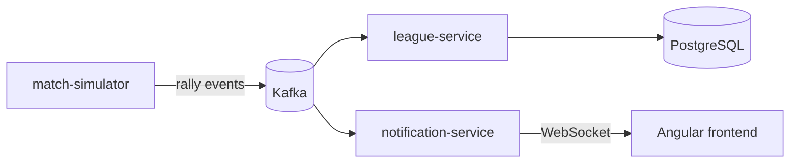

# volley-live

A volleyball league that plays itself. A simulator generates indoor volleyball matches rally by rally and publishes every point to Kafka. Other services read those events and turn them into live standings and player stats.

> Work in progress. For now the repo has the project skeleton and the local infrastructure. Features get added one at a time (see the roadmap below).

## Why volleyball

Every rally ends in a point, so a match is a steady stream of small, well-defined events. The rules also carry state: sets to 25 with a two-point lead, a fifth set to 15, rotations, who serves next. I wanted a problem where Kafka partitioning, event ordering and stateful stream processing actually matter, and I'd had enough of e-commerce order examples.

## How it works

Planned architecture:



Only `match-simulator` exists today. The rest will show up as the project grows.

## Tech stack

- Java 25, Spring Boot 4.1
- Apache Kafka 4.3 (KRaft mode) with Spring for Apache Kafka
- PostgreSQL 18
- Angular 22
- Maven multi-module build, Docker Compose for the infrastructure

## Project structure

```
volley-live/
├── services/
│   └── match-simulator/   # generates matches and publishes rally events
├── frontend/              # Angular app
├── docs/adr/              # architecture decision records
└── compose.yaml           # Kafka, Kafka UI and PostgreSQL
```

## Getting started

You need JDK 25, Docker with Compose, and Node.js LTS if you want to run the frontend.

Docker doesn't have to run on the machine you develop on. I run the containers on a Raspberry Pi on my local network, so the setup takes the Docker host as a variable.

### 1. Start the infrastructure

```bash
cp .env.example .env
# Set KAFKA_EXTERNAL_HOST to the IP of the machine running Docker.
# Leave it as localhost if Docker runs on this machine.
docker compose up -d
```

Kafka UI will be available at `http://<docker-host>:8090`.

### 2. Run the simulator

If Kafka isn't on localhost, set `KAFKA_BOOTSTRAP_SERVERS=<docker-host>:9092` first.

```bash
./mvnw -pl services/match-simulator spring-boot:run
```

Health check: `http://localhost:8081/actuator/health`

### 3. Run the frontend

```bash
cd frontend
npm install
npm start
```

Then open `http://localhost:4200`.

## Roadmap

- [x] Project skeleton
- [ ] Simulator publishing rally events to Kafka
- [ ] Standings and player stats with Kafka Streams
- [ ] Live scoreboard in the frontend
- [ ] Fantasy mode

## License

MIT